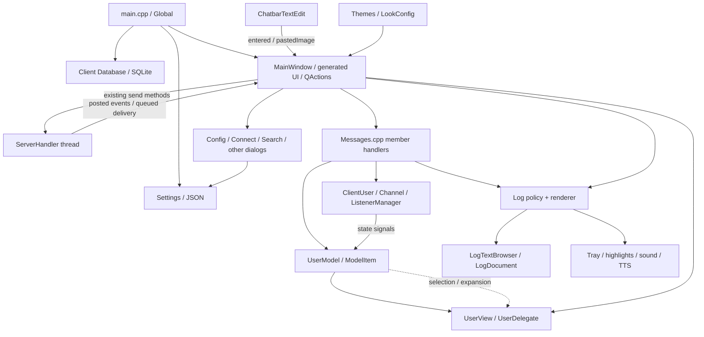
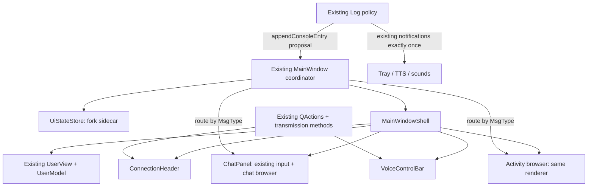

# Native UI modernization architecture

Status: **proposal for review; no UI implementation authorized by this document**.
Research date: 2026-11-09. Development branch: `1.6.x-new-ui`.
Inspected HEAD: `0440954f33f9f7bebd936151f62171895260ebcb`.
Upstream base: `535bb98ec4fb550f3b8f6b03028d44431c80a724` (`1.6.x`).
The two intervening commits add/update [baseline.md](baseline.md); application
source is unchanged from that base. All unqualified source references below
refer to this checkout, with line numbers at the inspected HEAD. A local
`v1.5.939` comparison is explicitly identified where used; no branch switch
was performed. Unless qualified otherwise, client filenames below are under
`src/mumble/`.

## 1. Executive summary

Keep `MainWindow` as the `QMainWindow`, action owner, and client coordinator.
Compose a new central widget from native Qt Widgets around the **existing
single `UserView`/`UserModel`, chat input, actions, dialogs, and message paths**.
Do not introduce an application framework, second client model, QML, web
renderer, new protocol, or audio/network rewrite.

Required decisions:

1. Isolate fork window geometry, layout, minimal mode, and restoration recovery
   in a per-profile sidecar when integrating the new shell. Build and test the
   store independently first, retaining official window persistence until the
   atomic shell/persistence transition. Never put fork values into shared
   `Settings`: startup restoration, configuration acceptance, session shutdown,
   and normal shutdown can all save it.
2. Keep one authoritative tree selection. Improve its delegate and surrounding
   layout before considering separate channel and user views.
3. Bind voice buttons to existing `QAction`s. Reuse `setTransmissionMode()`,
   `transmissionModeChanged`, and `bShowTransmitModeComboBox`.
4. Separate chat from activity at the **existing `Log::log()` presentation
   boundary**, after ignore/console policy. Retain one renderer implementation,
   HTML validation, resource restrictions, and notification/TTS policy.
5. Preserve application configuration identity and database selection. Give
   separately installed packages distinct executable/launcher identities without
   silently changing profile discovery or creating a competing RPC service.
6. Make same-base official **1.6.x ↔ fork** alternation a release gate. Full
   lossless **1.5.x ↔ 1.6.x** alternation has upstream blockers described in §5.7;
   it must not be advertised as already achieved by a UI sidecar.

The suggested normal layout is a connection header, horizontal splitter with
the existing tree on the left, chat/content on the right, switchable activity,
and persistent voice controls below. Splitters and visibility rules make
future layout changes local. Minimal view remains available. Retain the menu
bar and advanced actions for discoverability and keyboard access.

## 2. Current architecture — findings

### 2.1 State, data, and presentation

| Component and source anchor | Actual responsibility and ownership |
| --- | --- |
| `src/mumble/main.cpp:395,664,763,787,814,916` | Sets application identity, loads settings, creates the client database, main window, logger, tray, and audio; orchestrates shutdown. `Global` holds pointers/shared pointers to these objects. |
| `src/mumble/Global.h`; `Global.cpp:94` | Shared `Settings s`, server handler, audio objects, local session ID, permissions, listener manager, UI pointers. Not a presentation model that should be duplicated. Construction can create/migrate data directories. |
| `MainWindow.h:75`; `MainWindow.cpp:170,470`; `MainWindow.ui:22,98,129,172` | Inherits generated `Ui::MainWindow` publicly. Owns actions, menus, global-shortcut objects, dialogs, reconnect logic, permissions UI, and message handlers. `qtvUsers` is the central widget; `qteLog` and `qteChat` live in docks. |
| `Messages.cpp`, especially `msgServerSync()` and `msgTextMessage():1006` | Implementations of **MainWindow member functions**, not a separate message service. Update client/channel state, model, logging, and UI after protocol dispatch. |
| `ClientUser.h:78`; `src/Channel.h`; `ChannelListenerManager` | Live user/channel facts and listener relationships. `ClientUser` emits talking, mute/deaf, recording, priority, nickname, and volume changes. Session IDs are connection-scoped. |
| `UserModel.h:18,71`; `UserModel.cpp:413,1055,1718,1779` | `QAbstractItemModel` over channels/users and listener proxy rows. Owns `ModelItem` hierarchy/index bookkeeping, handles mutations and drag operations, exposes display/status/accessibility data. Also reaches into the main view for selection, expansion, scrolling, and tooltips. |
| `UserView.h`; `UserView.cpp:30,119,164,244` | `QTreeView` and existing `UserDelegate : QStyledItemDelegate`. Paints labels and status icons, handles comment hit areas, activation, filtering, and keyboard behavior. The delegate already exists; adding another is not inherently necessary. |
| `CustomElements.h:14,27`; `CustomElements.cpp:106,179,235,300` | `LogTextBrowser` supplies scroll helpers. `ChatbarTextEdit` supplies placeholder, completion, image paste/drop, multiline input, and a bounded in-memory sent-input history (50 entries). That input recall is not persistent chat history. |
| `Log.h:87`; `Log.cpp:642,717,979` | Event types, ignore counters, per-type output/notification policy, HTML validation, TTS/sounds, and direct insertion into `mw->qteLog`. `LogDocument` restricts resources. No structured conversation/message store. |
| `Settings.h`; `SettingsMacros.h`; `JSONSerialization.cpp:102,180`; `Settings.cpp:144,220` | Typed settings and macro-driven JSON serialization, defaults, certificates, backup/recovery, legacy import. Server-specific shortcuts are stored in the client database rather than generic shortcut JSON. |
| `Database.cpp:43,90,151,278` | Client SQLite discovery, schema initialization/upgrades, caches, favorites, certificates, tokens, friends, ignored users, nicknames, volume, filters, server shortcuts. Distinct from the server database abstraction/tests. |
| `Themes.cpp:28,90,152,206`; `LookConfig.cpp:193,278,366` | Global stylesheet/icon search paths, configured light/dark styles, user `user.qss`, appearance configuration, and some direct main-window updates. |



### 2.2 Thread and lifecycle constraints

`ServerHandler::message()` posts `ServerHandlerMessageEvent` to the main window
(`ServerHandler.cpp:725`); `MainWindow::customEvent():3903` parses/dispatches it.
Connection slots are connected in `MainWindow.cpp:1251`. `Log::log():719`
explicitly queues calls originating off its thread. Keep all new widget and
model-index work on the GUI thread. Do not attach GUI lambdas with direct
connections to audio/network callbacks. Plugin callbacks deliberately using
`Qt::DirectConnection` at `MainWindow.cpp:1262` are not examples to copy.

Startup creates the main window before `Log`, and then processes deferred logs
(`main.cpp:814`). The constructor calls `setupGui()` **before** assignment to
`Global::get().mw` completes. Pass `this`/widget references into new components;
do not fetch the global main window from their constructors or expect the
logger to exist yet.

Shutdown stops/waits for the server thread, drains pending events, stops audio,
then deletes the main window before releasing the server handler
(`main.cpp:922–976`). `MainWindow::~MainWindow():648` explicitly deletes the
model, tree, and root channel despite QObject parenting. Preserve this order
until deliberately replaced in an independently tested lifetime change.

## 3. Coupling hotspots and minimal boundaries

| Hotspot | Consequence / required boundary |
| --- | --- |
| `MainWindow` publicly exposes generated child pointers; `Global::get().mw` is used by `SearchDialog`, `TalkingUI`, `OverlayClient`, plugins, RPC, tray, audio, and others | Keep MainWindow identity and the `qtvUsers`, `qteChat`, `qteLog`, `pmModel` aliases valid during migration. They remain non-owning access paths, not additional objects. Do not mass-rewrite all global accesses. |
| `UserModel.cpp:402,897,993,1012,1203,1459,1653,1697` | Model selection, item moves, expanded state, tooltips, and removal assume the existing tree. Reparent that tree without replacing its model or selection model. A proxy/second authoritative view would require substantially more work. |
| `SearchDialog.cpp:527`; `TalkingUI.cpp:241,566`; `TalkingUISelection.cpp` | Search/talking UI invoke tree context menus and synchronize selection. Keep coordinate conversion and listener identity; an apparent duplicate user can be a listener row in another channel. |
| `UserDelegate::paint()/helpEvent()` and `UserView::mouseReleaseEvent()` | Painting and comment hit testing both depend on status icon order/width. If spacing/order changes, share one geometry calculation. Do not change paint alone. |
| `MainWindow.cpp:2253,3882,2647` | Sending, target placeholder, and permission enablement depend on selection and `bChatBarUseSelection`. Any new target label must use the same target resolver, not infer a destination from visible content. |
| `Log.cpp:743–821`; `LogConfig::accept():317`; `Themes::apply():159` | Log insertion, notification suppression, document limits, and stylesheet updates all assume one browser/dock. Replace these specific assumptions together before splitting the output. |
| `MainWindow.cpp:1039,1097,4352` | Context menus, image saving/viewing, and document resources are hardwired to `qteLog`. Helpers must receive the originating browser/cursor when two browsers exist. |
| `loadState():1432`, `storeState():1484`, `setupView():1498`, `closeEvent():721` | Startup, minimal-mode transitions, and close can mutate/save official layout. Separate persistence first. Changing only `setupUi()` is unsafe. |
| `OverlayClient.cpp:211,313` | Interactive overlay stores/restores main geometry and reparents it into a graphics proxy. Its calls must resolve fork minimal state and never persist overlay-sized geometry as the desktop default. |
| `ConfigDialog::apply():274`; `LookConfig::load()/save()` | Apply replaces the entire global `Settings` value; LookConfig normalizes layout/lock fields even without a deliberate layout edit. Disabled controls alone do not preserve them. |
| `MainWindow.cpp:575`; `QToolBar::insertWidget()` | The transmission combo is owned through a widget action. Do not delete that action while expecting a reparented combo to survive. Prefer constructing the one combo directly in its final container. |

Required seams are deliberately small: a window-state store; shell composition;
browser-parameterized log rendering/interactions; existing action binding; a
shared chat-target resolver if a second consumer is introduced. Broad extraction
of protocol handlers, a global event bus, repositories, or dependency injection
frameworks is unnecessary.

## 4. Proposed architecture

Everything named as new below is a **proposal**, not an existing API. Proposed
files are under `src/mumble/`; register them in the existing client target only
when implementation starts. Keep Qt 6.2 compatibility (`src/CMakeLists.txt:21`)
and the project's C++20 baseline.



### 4.1 Components and contracts

| Component / proposed location | Reuse, dependencies, communication, and state |
| --- | --- |
| Existing `MainWindow.{h,cpp,ui}` | Retain coordination, actions, dialogs, permissions, connection lifecycle, and message dispatch. Own shell/state-store objects. Add small forwarding/query methods; do not move networking into widgets. |
| `UiStateStore.{h,cpp}` | New small persistence helper plus value struct. Takes an explicit resolved file path; loads/validates/writes only fork UI state. Owns format/recovery state, no credentials, shared Settings serialization, database, or widget pointers. MainWindow translates widget state to/from values. |
| `widgets/MainWindowShell.{h,cpp}` | New QWidget composed of layouts/splitters. Receives the existing tree/input/browsers and child header/voice bar. Owns layout containers and transient visibility/focus state; exports splitter/visibility values to UiStateStore. Must not own a second model, network connection, or shared audio settings. |
| `widgets/ConnectionHeader.{h,cpp}` | Small view for server/connection status and buttons using `qaServerConnect`, `qaServerDisconnect`, `qaServerInformation`, `qaSearch`, favorites as appropriate. MainWindow pushes a display snapshot. Owns labels only; no reconnect timer or separate connection state machine. |
| Existing `UserView` / `UserDelegate` | Extend rendering, spacing, and shared hit-test geometry in `UserView.{h,cpp}`. Query existing model roles; use `getUser()`, `getChannel()`, `isChannelListener()` if needed for row type. Preserve status column, accessibility, selection, expansion, DnD, filtering. No new channel repository. |
| `widgets/VoiceControlBar.{h,cpp}` | QWidget with `QToolButton::setDefaultAction()` for `qaAudioMute`, `qaAudioDeaf`, `qaConfigDialog`, plus identity/status labels and the existing `MUComboBox` behavior. Receives actions and refreshed display data. Owns no mute/deaf/PTT/transmission truth. |
| `widgets/ChatPanel.{h,cpp}` | Layout wrapper around the existing `ChatbarTextEdit` and `LogTextBrowser`, plus explicit target label. Owns presentation only. Existing MainWindow send slots and permissions remain authoritative. Activity can be a tab/pane using the same browser implementation; no separate Activity controller is needed. |
| Extended `LogTextBrowser` in `CustomElements.{h,cpp}` | Move console text-frame insertion from `Log::log()` into a reusable append method. Each instance owns its own `LogDocument`, date separator state, cursor/scroll state. Both browsers use the same implementation and limits. Does not send messages or produce notifications. |

Use QObject parents for widget ownership and existing `qt_unique_ptr` conventions
where needed. Do not add an owning smart pointer on top of an unrelated parent.
Move the central tree using `takeCentralWidget()` before replacing the central
widget; Qt transfers ownership to the caller. Detach/reparent dock contents
before destroying their dock containers, remove installed `DockTitleBar` event
filters, and update the explicit destructor as one reviewed lifetime change.
Temporary empty docks may remain during a compiling intermediate commit, but
must never be restored, shown, or used as message-visibility truth. See Qt's
[QMainWindow ownership API](https://doc.qt.io/qt-6/qmainwindow.html#takeCentralWidget)
and [QWidgetAction ownership rules](https://doc.qt.io/qt-6/qwidgetaction.html#details).

Recommended minimal mode hides header/chat/activity and the menu bar, retaining
the tree and compact mute/deaf controls. Preserve the existing minimal-mode
shortcut and context-menu routes back to normal mode, including a disconnected
explanation. This is a visibility/layout change, not a second widget tree.

### 4.2 Connection, voice, and configuration synchronization

Use existing `serverSynchronized`, `disconnectedFromServer`,
`talkingStatusChanged`, `channelStateChanged`, model mutation/data-change
signals, and the local `ClientUser` signals (`MainWindow.h:418`,
`ClientUser.h:90`). Populate initial labels explicitly, then refresh on events.
Use MainWindow's existing connection/error/reconnect points to update transient
header text; **`serverConnected()` is a slot, not a signal**, and transport
connection is not yet server synchronization. Clear stale labels on disconnect;
resolve current objects by session/channel IDs or guarded `QPointer`s. Never
cache raw user pointers across reconnects.

Mute/deafen buttons use the same actions as menus/tray/shortcuts. The existing
handlers (`MainWindow.cpp:2779–2855`) implement coupled mute/deaf behavior,
`unmuteOnUndeaf`, wizard guards, protocol updates, and logging. Checked state
means the user's self-state; server mute/suppress/deaf and push-to-mute need
separate explanatory status, not a misleading toggle change.

The optional transmission combo retains indices Continuous/VAD/PTT, calls
`setTransmissionMode()` through `qcbTransmitMode_activated()`, and updates from
`transmissionModeChanged` (`MainWindow.cpp:856,1128,1686,3227`). Visibility uses
**only** `Settings::bShowTransmitModeComboBox`. Do not duplicate this preference
in the sidecar or emit mode changes when merely refreshing the combo.

`ConfigDialog::apply()` emits `settingsAccepted`, but changes `Settings`
directly; it does not call `setTransmissionMode()`. Extract the appropriate
refresh work from `openConfigDialog():4259` into a MainWindow helper connected
to `settingsAccepted`, including Apply, and use it for initial refresh. Keep
PTT-window visibility and action state synchronized. Do not introduce audio
restarts beyond the existing configuration flow.

### 4.3 Chat and activity: preserve semantics before improving appearance

Findings:

- Incoming `msgTextMessage()` drops locally ignored senders, distinguishes
  tree/channel/private scope, formats sender links, and computes TTS overrides.
  It passes a formatted HTML string to `Log`; it does not emit a structured
  message object. Server welcome text is `Log::Information`, while a server
  text message can be `Log::TextMessage`.
- Outgoing chat uses Markdown conversion or Ctrl+Enter plain-text escaping,
  then `sendChatbarMessage()`. Other paths include user/channel dialogs, tree
  sends, configured text shortcuts, and clipboard sends
  (`MainWindow.cpp:2118,2231,2603,3282`). Outgoing private echoes are currently
  `Log::TextMessage` with `ownMessage=true`, not `PrivateTextMessage`.
- `Log::log()` owns ignore counters, `Settings::LogConsole` eligibility,
  timestamps, notifications, TTS, sounds, and insertion. Its notification
  suppression currently tests active main window plus **log dock visibility**.
- `Log::validHtml():642` filters link schemes and oversized content;
  `LogDocument::loadResource():979` permits data images and rejects other
  external resources. Preserve these constraints and supported rich content.

Required first split:

1. Extract browser append logic without changing output. Proposed MainWindow
   method `appendConsoleEntry(Log::MsgType, const QString &, bool ownMessage,
   const QDateTime &)` forwards to the chosen browser. `Log::log()` calls it
   only after existing ignore and `LogConsole` decisions. Keep notification,
   sound, and TTS processing in Log, exactly once.
2. Route `TextMessage` and `PrivateTextMessage` to Chat; all other types to
   Activity, including welcome/errors/plugin events. Label both destinations
   clearly; show an unread indicator for hidden activity without generating a
   second notification. Do not classify by localized text or parse rendered
   HTML. Preserve chronological order within each stream and across reconnects
   for the life of this process; add no disk history.
3. Replace the dock visibility test with a proposed
   `MainWindow::isConsoleEntryVisible(MsgType)` query: active main window and
   the actual destination exposed, not an inactive tab or hidden/minimal pane.
   Preserve the other notification flags and own-message rules. Do not add a
   scroll-to-bottom requirement to notification suppression in this change.
4. Give each browser independent date/scroll tracking. Preserve own-message
   scroll-to-end, incoming-message scroll preservation, timestamps, trailing
   whitespace marking, and clear/copy/link/image behavior. Parameterize existing
   MainWindow log context-menu/resource helpers by source browser; never look
   up an activity image in the chat document.
5. Update `LogConfig::accept()` and `Themes::apply()` through a small MainWindow
   forwarding method so both documents receive limits/styles. Apply the existing
   `iMaxLogBlocks` setting to each; two documents can increase retained output
   and must be measured. Do not keep a hidden third copy or an unbounded message
   vector. Test actual eviction with rich content: Qt documents
   [maximumBlockCount as undefined for tables/frames](https://doc.qt.io/qt-6/qtextdocument.html#maximumBlockCount-prop),
   and the current renderer inserts frames. Merely setting that property does
   not prove bounded memory. If the fixture reproduces ineffective eviction,
   implement a separate, reviewed renderer fix that trims oldest complete
   entries using the existing block budget and releases their resources;
   preserve the existing unlimited setting. Do not silently strip rich content.

Keep the initial chat as a single process-local stream with explicit targets,
not per-channel tabs. Switching visible content must not redirect the composer.
If a separate target label is added, extract the existing selection/fallback
decision into a shared MainWindow resolver used by sending and `updateChatBar()`;
resolve again on send and preserve current permission checks. Test selected
user, selected channel, self, no selection, listener proxy, and
`bChatBarUseSelection=false`. No new conversation routing policy is implied.

Optional later work: structured in-memory message metadata captured **before**
HTML formatting if a reviewed design requires conversation filtering; a
secondary read-only user list after selection/index mapping is designed;
further model/view decoupling when a concrete second consumer needs it. None is
a prerequisite for the first usable shell.

## 5. Configuration compatibility — required design

### 5.1 Identity and actual discovery rules

Keep `QApplication` application name `Mumble`, organization `Mumble`, and domain
`mumble.info` (`main.cpp:400`). A filename such as `mumble-new-ui` does not by
itself change these explicit identities. Renaming the QApplication to brand the
fork **would** change standard paths and legacy QSettings lookup. Use a window
title/launcher label for branding instead.

| Resource | Actual selection at this HEAD |
| --- | --- |
| Shared JSON | Explicit `--config` must exist and be writable (`main.cpp:265,422`). Otherwise `Settings::findSettingsLocation():1260` checks executable directory, `AppLocalDataLocation`, `AppConfigLocation`, `ConfigLocation`, then QSettings' directory for writable `mumble_settings.json`; default is `AppConfigLocation/mumble_settings.json`. Standard paths depend on platform/environment and identity; do not hardcode one Linux path. |
| Loaded/save target | `Settings::settingsLocation` records the chosen file; backup loads strip `.back` back to the primary target (`Settings.cpp:48,220`). With no existing JSON/legacy import, `save()` resolves the default/discovered location. |
| Data base directory | `Global.cpp:144`: normally `AppDataLocation`; explicit `--config` instead uses that file's directory. Global may move legacy data before settings are loaded, and creates Plugins/Overlay/Themes directories. |
| Client SQLite | `Settings::qsDatabaseLocation` (`misc.database_location`) takes precedence. Otherwise `Database::findOrCreateDatabase():43` searches base directory, AppLocalDataLocation, Unix legacy `~/.config/Mumble`, home, working directory, executable directory, and QSettings `InstPath`; tries `.mumble.sqlite` before `mumble.sqlite`. It then creates in the first usable candidate and records the selected path. |
| Other shared resources | Certificates are serialized in settings; trust pins/favorites/tokens/server shortcuts are in SQLite. Themes, `user.qss`, plugins, overlay resources derive partly from `qdBasePath` and installation paths. Preserve those resolutions. |

Two separately installed binaries can choose **different** profiles if a
portable JSON sits next to one executable, their working directories contain
different databases, or sandboxed packages expose different homes. Same
application name is necessary but insufficient. Resolve and compare the actual
JSON and SQLite paths for each supported package. Where selection is ambiguous,
use the existing explicit JSON path and an explicit valid database path in a
deliberately prepared profile. Never search-and-copy profiles automatically.
Do not redirect the database merely because the UI changed.

An existing configured SQLite file that fails to open can also fall through
to `findOrCreateDatabase()` (`Database.cpp:94–137`), changing the selected path.
Include this failure case in compatibility testing; do not certify a run that
silently used another database. Any fix to fail clearly instead of falling
back is a separate foundation bug-fix commit, with no schema change.

Packaging recommendation: separate executable/install directory and desktop
entry (e.g. `mumble-new-ui`, `info.mumble.Mumble.NewUI.desktop`), preserving
configuration identity. Match `setDesktopFileName()` to that launcher for
Wayland grouping. Existing identities requiring a packaging audit include
`StartupWMClass=mumble` and the URL handler in
`auxiliary_files/config_files/info.mumble.Mumble.desktop.in`, the Windows
AppUserModelID in `os_win.cpp:255`, the installer upgrade GUID in
`installer/ClientInstaller.cs:30,144`, and `CFBundleIdentifier=mumble-client`
in `src/mumble/mumble.plist.in:11`. Reusing the installer upgrade identity can
replace the official installation. Assign fork installation identifiers and
recheck profile paths; do not silently take over `mumble://` associations.
This architecture task changes no packaging.

### 5.2 Shared JSON and database remain upstream-owned formats

Continue using `Settings::load()/save()` and `JSONSerialization`. Do not add
fork fields to `SettingsMacros`, change standard key meanings, bump shared
settings version, or add client database tables. JSON currently has
`settings_version=1`, omits values equal to defaults, specially serializes
shortcuts/messages/plugins/certificates, and reconstructs known fields rather
than preserving arbitrary unknown JSON (`JSONSerialization.cpp:102–224`).
Semantic compatibility does not mean byte-identical indentation/key presence.

Ordinary deliberate changes to audio devices, transmit mode, PTT, hotkeys,
connection behavior, certificates, bookmarks, shared theme choices, and other
supported settings must still reach the original client. Never restore an
entire startup `Settings` snapshot at exit: that would discard these changes.
Do not force new audio defaults or select a new shared theme to obtain the new
layout. Use existing palette/style assets and scoped shell styles.

Database initialization is **not read-only**: it creates/upgrades tables,
expires caches, vacuums, changes journal mode, and adjusts permissions
(`Database.cpp:151–276`). `main.cpp:765` also clears local-muted rows. Preserve
the upstream schema and its normal operations, with no fork data or message
history. Compare durable rows and schema, not SQLite file hashes. Record normal
cache expiry/local mute clearing separately from loss of durable user data.

The existing settings saver uses a fixed temporary filename and one backup per
process (`Settings.cpp:144–218`); it is not a lossless concurrent-merge mechanism.
Keep its behavior in this UI project. Alternation assumes the prior process has
fully exited; crashes and failed writes still need tests and visible errors.

### 5.3 Protect the official window preferences at every save point

These rules take effect with the new shell in Stage 2. Stage 1 implements and
tests `UiStateStore` independently; the running legacy shell keeps its existing
official persistence behavior. Do not migrate legacy dock state into the
sidecar. Activate all persistence routing and protected-settings handling in
the same atomic commit that integrates the new shell, with compatibility tests.

**Do not call the old `loadState()` body for the new shell.** It clears the
chosen geometry/state, sets `preventWindowStates=true`, saves shared JSON,
attempts restore, then stores the current layout and saves again. Ignoring the
saved geometry, returning early only from `storeState()`, or restoring old
bytes just at shutdown does not protect against the earlier write/crash.

The following shared fields are protected from fork layout operations:

| Shared fields (`ui` JSON keys) | Fork treatment |
| --- | --- |
| `qbaMainWindowGeometry`, `qbaMainWindowState` (`window_geometry`, `window_state`) | Leave loaded values intact, including unknown opaque bytes. Never restore them into the fork shell. |
| `qbaMinimalViewGeometry`, `qbaMinimalViewState` (`minimal_view_window_geometry`, `minimal_view_window_state`) | Same rule for minimal mode. |
| `preventWindowStates` (`prevent_window_states`) | Leave intact. Read-only safety veto on restoration; never use as the fork's crash latch. |
| `bMinimalView`, `bHideFrame` (`minimal_view`, `hide_frame`) | Seed fork defaults once if no sidecar exists; thereafter use fork state. MainWindow/overlay reads and action writes must use that state. |
| `wlWindowLayout`, `bLockLayout` (`window_layout`, `lock_layout`) | Preserve official layout choice. They do not select/rearrange the new shell. |

Implementation instructions:

- Keep `MainWindow::loadState(bool)` / `storeState(bool)` as narrow wrappers
  around fork persistence while migrating callers, or rename them with all
  callers updated in the same atomic change. Route startup, minimal toggles,
  accepted close, session-end, and interactive overlay through the same policy.
- Replace **all runtime** `s.bMinimalView` / `s.bHideFrame` uses in MainWindow
  and overlay with the fork state/accessor, including menu composition, title,
  always-on-top conditions, disconnected note, and context menus. Do not merely
  change the toggle slots at `MainWindow.cpp:2880`.
- In `LookConfig`, retain existing dialogs but disable/explain legacy layout,
  lock, and shared window-restore controls for this shell, and skip their
  normalization/save paths. Provide fork layout reset/restore control locally.
  Additionally copy the nine protected fields from current global settings
  into the dialog's candidate settings **before** `ConfigDialog::apply()`
  assigns it globally. A small shared copy helper is sufficient; use it for
  Apply/OK/reset paths rather than duplicating the field list. This makes
  resetting unrelated settings unable to reset the official window state.
- Keep unrelated dialog geometry (Connect, Search, PTT, TalkingUI, etc.) on
  its existing upstream path while those dialogs remain unchanged. Do not
  overwrite their geometry as a side effect of placing the new shell.
- Honor `--no-window-states` as a no-restore/no-capture override for opaque
  window geometry; do not change shared latches. The shared
  `preventWindowStates` safety veto remains read-only as well.
- Test protected values at **every shared save**, including configuration OK,
  `MumbleApplication::onCommitDataRequest():36`, migration save at
  `main.cpp:678`, and shutdown. No end-of-process repair strategy is acceptable.

`MainWindow::stateVersion():222` currently XORs Qt version with the `.ui` hash.
That version concerns old dock serialization; it is not a migration mechanism
for a new widget topology and does not protect `restoreGeometry()`.

### 5.4 Fork sidecar format and recovery

Proposed path: append `.new-ui.json` to the **resolved primary settings file**,
e.g. `/profile/mumble_settings.json.new-ui.json`. Resolve after successful
settings load/backup selection; when `settingsLocation` is empty use the same
`findSettingsLocation()` result that shared saving will use. Normalize the
primary absolute **write path**, and if `settingsLocation` was empty pin that
resolved path there (this runtime member is not serialized). Freeze the selected
profile for the run. Do not canonicalize only the sidecar: the shared saver
renames/replaces its target, so two different symlink aliases are not proven to
remain one profile after saving. Require both binaries to use the same write
target and test file identity across saves. Different named JSON profiles in
one directory must get different sidecars. No executable-relative or
working-directory sidecar.

Minimal illustrative format (names are proposed):

```json
{
  "version": 1,
  "layoutRevision": 1,
  "qtVersion": "6.2.0",
  "restoreBlocked": false,
  "minimal": false,
  "hideFrame": false,
  "normal": { "geometry": "", "splitterSizes": [240, 720] },
  "compact": { "geometry": "" },
  "activityVisible": true
}
```

`geometry` is base64 of Qt geometry bytes. Use explicit splitter sizes and pane
visibility instead of `QMainWindow::saveState()` for a fixed shell. Add fields
only when used; no copied shared preferences, credentials, server history,
message content, or user/channel IDs. Default dimensions are suggestions,
clamped to available screen space and widget minimums. Default normal mode is
usable even without a file. Seed only compatible simple preferences once; do
not import legacy dock blobs or alter them.

Versioning is justified by the planned incremental topology changes and opaque
Qt geometry. `version` describes the JSON schema; `layoutRevision` describes
compatible layout fields. Retain geometry only for the recorded compatible Qt
version; initially require an exact match and fall back to safe placement on
mismatch. Reject oversized/invalid base64, negative/implausible sizes, wrong
types, and unsupported versions before calling Qt. Bounds checking is not a
guarantee that arbitrary Qt geometry is safe.

Use existing JSON support and `QSaveFile(QString)` with checked writes/commit,
without direct-write fallback, for this **new file only**. This gives a
same-directory replacement without extending the shared saver. See
[QSaveFile semantics](https://doc.qt.io/qt-6/qsavefile.html#details).

Before restoring opaque geometry, retain candidate bytes in memory, atomically
write the sidecar with those bytes cleared and `restoreBlocked=true`, and only
then attempt restoration. If the guard write fails, skip restoration. On
success, save current valid values and clear the latch. After a crash, use safe
defaults and keep restoration blocked until the user resets fork layout. A
false Qt restore result also falls back safely. Never write the shared JSON
as part of this sequence. Invalid files should be diagnosed and preserved for
recovery; unknown newer versions must not be overwritten by an older fork.
Missing/unwritable sidecars allow a usable session with unsaved layout and a
visible diagnostic, never a fallback write into shared settings.

### 5.5 Shutdown, restart, and two installed executables

Normal sequence after the atomic shell/persistence transition:

1. Official client exits fully; its settings/database become authoritative.
2. Fork discovers the same profile, loads shared settings/database normally,
   and independently loads its sidecar. No shared layout restore/save occurs.
3. User actions change ordinary shared settings through existing paths; shell
   changes only affect sidecar values. A minimize-to-tray close is not exit.
4. On accepted close capture fork geometry before widget destruction. Also
   capture via the session-end path; make the common capture idempotent and
   skip overlay-proxy geometry. Retain the existing main shutdown ordering,
   `mumbleQuitNormally` handling, and database finalization.
5. Official client starts again and reads its untouched window preferences
   plus intentional shared changes. On the next fork run, reload shared data
   anew; do not replay an old settings snapshot from the sidecar.

**Required foundation fix:** restart at `main.cpp:1020–1054` launches
`qApp->applicationFilePath()` but rebuilds arguments without `--config`.
An explicit profile can consequently become the default profile on restart.
Preserve the resolved explicit config argument and relevant identity/profile
options before Global teardown; pass distinct argv elements (test spaces and
non-ASCII paths, including Windows quoting). Keep reconnect URL behavior.
Audit `--default-certificate-dir` and other intentionally retained CLI options
in the same profile-continuity tests. Do not force `--multiple` to make restart
work; the Windows user lock is deliberately released before relaunch.

Single-instance behavior is application-wide, not executable/profile-specific:
`main.cpp:593–661` forwards focus/URLs to D-Bus
`info.mumble.mumble` (also legacy `net.sourceforge.mumble.mumble`) or SocketRPC
basename `Mumble`. Unix sockets use `$XDG_RUNTIME_DIR/MumbleSocket` or
`~/.MumbleSocket` (`SocketRPC.cpp:233,279`); Windows also uses a base-directory
`mumble.lock`. Keep these IPC identities for alternation. Launching the fork
while official Mumble runs can focus that existing client instead of opening
the fork, even with a different `--config`. Document this behavior. Linux RPC
is not a race-proof profile lock, and mixed D-Bus build capabilities deserve a
packaging smoke test. Simultaneous/racing starts and `--multiple` sharing a
profile are outside the guarantee.

### 5.6 Defaults, migration, and safe test profiles

New UI preferences migrate only in the sidecar. No shared settings migration
is necessary for the shell. Preserve existing legacy discovery behavior; do
not add a second legacy-import implementation. `Global::migrateDataDir()` can
move old files before load, so test that path with disposable directories,
especially when alternating Qt generations or installation types.

Use the reproducible JSON profile in [baseline.md §6](baseline.md#6-protecting-the-original-mumble-configuration).
Explicit `--config` here calls the JSON loader, not `legacyLoad()`, and
`save(path)` requires a `.json` suffix. The recipe creates a separate SQLite
file and isolates application data, configuration, cache, temporary-file and
certificate paths. Keep both clients closed between launches; use disposable
OS profiles/IPC namespaces for failure and restart tests that can reach legacy
fallback paths. No tests in this research launched a client or opened the
user's database.

### 5.7 Version compatibility is bounded, not assumed

Local source comparison: `v1.5.939` =
`dfbac8d3d9c967003e74b4ffc5610f7d45e8f666`, against the inspected branch HEAD.
This is one concrete 1.5 release, not a claim about every 1.5.x build.

- Both serialize JSON settings version 1. The 1.5 serializer also reconstructs
  only its known fields, so it drops newer 1.6 keys on save (e.g. listener
  attenuation, dark-theme selection, TalkingUI background color). A fork-only
  sidecar cannot stop the official older client doing this.
- 1.6 adds recording enum strings `MultichannelAndTransport` and
  `TransportStandalone` (`EnumStringConversions.cpp:85`). The inspected 1.5
  converter accepts only Mixdown/Multichannel and throws for unknown strings;
  its settings loader catches JSON parse errors, not this conversion throw.
  Selecting such a mode can prevent the older client loading the profile.
- No SQL schema statement changes were found between those snapshots in
  `src/mumble/Database.cpp`, but 1.6 startup adds `clearLocalMuted()`. This is a
  data behavior difference even with an unchanged schema.
- Qt-generation path differences, data migration, platform-specific hotkey
  encoding, available audio backends, and build-time noise-canceller support
  require actual build-pair tests. The JSON loader can substitute Speex when
  RNNoise support is absent (`JSONSerialization.cpp:220`). Do not equate
  successful parsing with preserving effective behavior.
- Preserve existing QDataStream version pins for generic shortcut values
  (`JSONSerialization.cpp:256`) and database shortcuts (`Database.cpp:635`).
  They help compatibility but do not prove every native key mapping works.

Recommendation: certify official 1.6 builds with compatible feature sets first;
review the exact original binary/version before claiming alternation support.
If full 1.5 losslessness is mandatory, resolve it as a prerequisite compatibility
work package, not a styling task. It would require constraining newer shared
values and an agreed strategy for old clients discarding new upstream settings;
those are non-UI semantics and conflict with simply keeping all upstream
1.6 behavior. No blanket backward-compatibility claim is justified today.

## 6. Incremental implementation roadmap

Work on the one shared `1.6.x-new-ui` branch, in dependency order. Each numbered
commit below is a separate logical change, compiling independently with its
focused tests. Keep protocol/audio/server changes out of these packages. Do
not leave passing builds with temporarily broken persistence. Avoid two agents
editing MainWindow/Log/ConfigDialog concurrently; hand off at reviewed commits.

### Stage 1 — foundation and compatibility (release-blocking)

- **Scope/files:** new `UiStateStore.{h,cpp}` and focused Qt test targets;
  `main.cpp` for explicit-profile restart continuity. Inspect `Settings`,
  `JSONSerialization`, and `Global` for profile-resolution test fixtures.
- **Refactorings:** implement and test the sidecar helper independently, with
  explicit paths and value structs, without connecting it to the running UI.
  Keep official `MainWindow::loadState()/storeState()` behavior and existing
  settings handling until Stage 2. Do not add temporary legacy dock fields or
  migrate legacy layouts to the sidecar. Fix explicit-profile restart separately.
- **Dependencies:** this document's review and selected official 1.6.x/fork
  compatibility pair. No layout work depends on unresolved 1.5 claims.
- **Risks:** invalid sidecar data, recovery loops, path mismatch, restart
  changing profile, accidentally activating fork persistence too early.
- **Acceptance/tests:** isolated `TestUiStateStore` covers parsing, defaults,
  validation, atomic writes and recovery transitions with temporary files.
  Profile/restart fixtures verify JSON, DB and certificate path continuity.
  The legacy UI still restores/saves official window state; normal application
  runs do not create/use a sidecar yet. Prepare §7 compatibility fixtures for
  Stage 2, which activates the protected-field invariants.
- **Atomic commits:** (1) sidecar parser/writer plus isolated tests;
  (2) explicit-profile restart fix plus argument tests. Do not mix unrelated
  upstream fixes into these commits.

### Stage 2 — main shell

- **Scope/files:** MainWindow setup/view/popup/focus methods, `.ui`,
  `CustomElements`, `Log`, `UiStateStore`, `LookConfig`, `ConfigDialog`,
  `MumbleApplication`, and overlay callers; new `MainWindowShell`,
  `ConnectionHeader`, `ChatPanel`.
- **Refactorings:** first introduce the console-visibility query while the old
  dock still exists. Then take/reparent the existing tree and chat widgets into
  native splitter/layout containers. Keep combined log output initially. Adapt
  minimal view, menu actions, title bars, and destructor consistently. Keep the
  old toolbar controls accessible until Stage 4 replaces their placement.
  In that same shell integration change, activate fork-specific persistence
  and **all** §5.3 protected-settings handling: runtime minimal/frame reads,
  startup/close/session/overlay routing, LookConfig save suppression, and the
  ConfigDialog protected-field guard. Use the new shell's sidecar format
  directly; never pass its state through official persistence.
- **Dependencies:** tested Stage 1 store and profile continuity; initial shell
  layout revision and compatibility fixtures ready before integration.
- **Risks:** deleted central widget, dangling dock filters, invisible actions,
  early shared writes, dialog-copy normalization, stale state version,
  `show()/setWindowFlags()` platform effects.
- **Acceptance/tests:** connect/settings/search are reachable; exact model and
  selection objects survive; resize, narrow window, minimal/normal transitions,
  tray reopen, and repeated construction/destruction work. At every shared
  save, startup/toggles/Apply/OK/reset/session shutdown/overlay round-trip and
  injected restoration crashes preserve all nine protected fields; intentional
  audio/bookmark edits remain shared. Pass §7.2 compatibility fixtures and §7.3
  official 1.6.x/fork alternation at the transition commit. Qt offscreen shell
  fixtures check parentage/focus/visibility.
- **Atomic commits:** (1) visibility query refactor with legacy behavior;
  (2) shell ownership/minimal-view integration **plus complete fork persistence,
  protected-settings handling and compatibility tests as one atomic change**;
  (3) connection header presentation. Do not split commit 2 into an intermediate
  shell using shared layout persistence or an intermediate legacy sidecar
  migration. New file creation and its build registration belong together.

### Stage 3 — channel/user navigation

- **Scope/files:** `UserView.{h,cpp}`, only necessary role changes in
  `UserModel.{h,cpp}`, accessibility helpers, scoped theme selectors.
- **Refactorings:** share status geometry between paint/help/click handling
  before altering it. Use hierarchy, typography, spacing, and status icons to
  distinguish channels/users/listeners. Retain compact rows, drag payloads,
  `uniformRowHeights` unless deliberately revised, and existing activation.
- **Dependencies:** Stage 2; the existing view remains authoritative.
- **Risks:** mismatched comment hitboxes, lost listener context, broken
  keyboard activation or filtered/expanded state.
- **Acceptance/tests:** all status combinations remain discoverable; channel
  and user Ask/Move/DoNothing drag modes, restricted operations, links,
  listener removal/volume, search selection, comments, and tree moves work.
  Test roles and geometry with synthetic model fixtures; protocol results need
  a local server. Test RTL, large fonts, high contrast, and keyboard menus.
- **Atomic commits:** (1) shared geometry refactor; (2) delegate presentation;
  (3) any separately justified accessibility fixes. No model rewrite.

### Stage 4 — persistent voice controls

- **Scope/files:** new `VoiceControlBar`; MainWindow toolbar/combo setup and
  settings refresh; existing mute/deaf/transmission methods remain the backend.
- **Refactorings:** bind buttons to existing actions, place the one combo in
  the new bar, remove obsolete widget-action ownership cleanly. Share refresh
  logic for construction, settings Apply/OK, and existing state signals.
- **Dependencies:** Stage 2; can follow Stage 3 without relying on its painting.
- **Risks:** duplicate toggles/signals, combo feedback, self-state confused with
  server state, stale settings after Apply, inaccessible icon-only buttons.
- **Acceptance/tests:** mouse, menu, tray, RPC, and global shortcut paths agree;
  mute/deafen coupling, server mute/suppression, wizard restrictions, three
  transmit modes, and optional combo visibility behave as before. Component
  tests use fake QActions/QSignalSpy; handler and server tests verify real effects.
- **Atomic commits:** (1) settings-refresh refactor; (2) voice bar action binding;
  (3) combo relocation using existing setting/logic. Keep one functioning control
  path at each intermediate commit.

### Stage 5 — chat/activity split

- **Scope/files:** `Log`, `CustomElements`, MainWindow log/image handlers,
  `Themes`, `LogConfig`, `ChatPanel`; no protocol modifications.
- **Refactorings:** extract append renderer first while combined output remains;
  parameterize browser-specific interactions; then route by event type and
  update visibility policy, style/limits, and activity indicators together.
  Introduce shared target resolution only with the explicit target label.
- **Dependencies:** Stages 1–2; follow Stage 4 to avoid MainWindow conflicts.
- **Risks:** missing/duplicated messages, unsafe rich content, wrong-target
  sending, duplicate notifications, image resource mismatch, hidden errors.
- **Acceptance/tests:** replay every send/receive source into fixtures; verify
  routing, timestamps, scroll, links/images, ignore/LogConsole settings,
  notifications, TTS/sound calls, and memory caps. No server needed for renderer
  policy tests; use a server for delivery, permissions and reconnect behavior.
- **Atomic commits:** (1) reusable renderer; (2) source-browser interaction
  helpers; (3) routing with visibility/style/limits integration; (4) target-label
  resolver refactor and presentation as separate commits if independently useful.

### Stage 6 — integration parity

- **Scope/files:** existing dialogs, Search/TalkingUI, OverlayClient, tray,
  MainWindow focus/menu/minimal paths, `Themes`, platform integration.
- **Refactorings:** only concrete compatibility adapters still needed; remove
  obsolete dock containers/aliases once all their consumers are accounted for.
  Keep required `qtvUsers`/`qteChat` compatibility access paths; do not make
  encapsulation cleanup a prerequisite for release.
- **Dependencies:** Stages 2–5; integration checks also run at earlier stages.
- **Risks:** rarely used advanced actions disappear, overlay saves wrong size,
  floating/transient windows outlive their parent, global QSS changes dialogs.
- **Acceptance/tests:** settings/connect/audio/certificate dialogs, recording,
  search, listeners, ACLs, context menus, PTT window, minimal view, hide frame,
  always-on-top, tray, overlay, RPC/URLs, and keyboard focus pass the parity
  checklist. Unsupported platform facilities are compared with the same-base
  official client, not assumed to work from offscreen tests.
- **Atomic commits:** each discovered parity defect separately; final removal
  of obsolete dock scaffolding separately. No cosmetic cleanup mixed into fixes.

### Stage 7 — testing and polish

- **Scope/files:** new test fixtures under `src/tests/`, scoped widget/theme
  adjustments, translations/accessibility, test instructions in `docs/new-ui/`.
- **Refactorings:** only those required by measured correctness failures.
- **Dependencies:** all earlier acceptance criteria; real build-pair fixtures.
- **Risks:** platform-only failures and falsely treating baseline failures as
  UI regressions (or ignoring new failures as baseline).
- **Acceptance/tests:** §7 matrix passes on supported platforms; repeated
  alternation leaves official layout intact; all focused tests and the full
  configured suite run with any baseline blocker reported precisely. Record
  small startup/memory/responsiveness comparisons and fix visible regressions.
- **Atomic commits:** test additions accompanying their behavior where possible;
  separate final accessibility, layout, platform fixes, and documentation
  records. Each commit uses `TYPE(Scope): Summary` and ends with `AI-assisted`.

Large implementation proposals should be discussed before coding as repository
guidance requests. This plan does not authorize a GitHub issue, push, or PR;
those still require an explicit request and the repository understanding gate.
Local implementation commits need no publishing gate.

## 7. Testing strategy

### 7.1 What exists and what was verified here

`src/tests/CMakeLists.txt` registers QtTest executables. The client-specific
suites are `TestXMLTools` and generated `TestSettingsJSONSerialization`.
The latter links `mumble_client_object_lib` and checks serialization round trips;
it excludes certificate generation and does **not** exercise settings-file
discovery, backups, MainWindow restoration, or two-client alternation.
`TestDatabase` early-returns when the server is disabled; it does not cover
`src/mumble/Database.cpp`. No existing focused shell/navigation/chat integration
suite was found among the registered tests.

[baseline.md](baseline.md) records a built client and 16/17 passing suites, with
`TestMumbleProtocol` not built due to protobuf nodiscard warnings under
warnings-as-errors. This research checked source and existing CMake cache
(`client=ON`, `server=OFF`, `tests=ON`, Release), but **did not rebuild or rerun
those tests**. Those results remain the prior baseline, not validation of this
proposal. Never disable that test or weaken warnings to declare a green suite.

For implementation, initialize submodules and use the baseline's Ninja build.
Run `ctest --output-on-failure` from the build directory. Keep warnings-as-errors;
check changed includes with `CMAKE_UNITY_BUILD=OFF` and standalone compilation.
CI's dependency-provider/unity configuration is an additional integration
target, not a substitute. Add tests in existing per-directory CMake style;
component tests can link only required Qt/client sources, while stateful client
tests can follow the existing object-library pattern. Use `QT_QPA_PLATFORM=offscreen`
for isolated fixtures; native input/accessibility still needs desktop testing.

### 7.2 Automated coverage without a server

| Proposed fixture | Concrete assertions |
| --- | --- |
| `TestUiStateStore` | Stage 1, independent of MainWindow: temp-only paths; missing file defaults; round trip; two profiles in one directory; backup-normalized/symlink paths; invalid JSON/types/base64/size bounds; unsupported version preserved; failed atomic writes; simulated pre-restore latch and failed/crashed restore recovery. |
| `TestUiConfigurationCompatibility` | Required in the atomic Stage 2 integration commit. Seed official geometry/state with distinguishable bytes and nondefault layout/minimal/lock/latch values. Run fork capture/restore/toggles, config Apply/OK/reset and session save in an isolated harness. Inspect shared JSON **at each save**; protected fields unchanged, intentional audio/transmit/hotkey edits retained, no fork keys. Compare schema version/default interpretation. Include a test certificate and compare fingerprint/key identity rather than exported container bytes. |
| Profile/restart process test | Launch/restart fixture with explicit path containing spaces/non-ASCII and a different default profile sentinel. Assert both generations resolve the same JSON, sidecar, DB and certificate location, and invoke the fork executable. Inject process exit after guard save without executing deliberately corrupt Qt blobs. |
| `TestMainWindowShell` | Inject real widgets/actions into shell without audio startup or server; check same object identities, parents, minimum sizes, focus order, hidden-pane behavior, normal/minimal transitions, destruction after queued events. Use `QPointer` destruction observations. |
| `TestUserNavigation` | Synthetic channels/users/listeners, roles/accessibility, selection preservation during moves/removal, icon hit regions, RTL/font scaling. Existing model globals need a minimal isolated Global/DB fixture, or use a tiny fake model for delegate-only tests; never start the full application to test painting. |
| `TestVoiceControlBar` | QAction enabled/checked propagation, exactly one trigger per click, initial state, programmatic refresh without feedback, combo visibility and indices, settingsAccepted refresh. This alone does not prove global hotkey capture or network self-state. |
| `TestLogPresentation` | Feed all Log event types through ignore/console policy; assert chat/activity routing and exactly-once notification signals with QSignalSpy. Stub TTS/sound at their existing boundary. HTML/link/resource restrictions, data images, whitespace, both image menus, date changes, scroll preservation, caps, hidden/minimal panes. Renderer tests can call the extracted browser method directly; policy tests need a minimal MainWindow/Log harness. |
| Client SQLite compatibility fixture | Temp database seeded with favorites, cert pins, tokens, shortcuts, filters, nicknames, volume and friends. Open with both tested client data layers; compare schema and durable rows, allowing only documented cache expiry/local mute cleanup. `PRAGMA integrity_check` afterward. No server-database fixtures as a substitute. |

Use disposable HOME/XDG/AppData and an isolated IPC namespace for process tests.
`--config` alone is insufficient isolation. Do not introduce broad mocking
frameworks or an alternate protocol layer merely to avoid a few integration
tests. Create small seams only around the behavior under test.

### 7.3 Alternating-client release test

For each named official/fork build pair, on a disposable shared profile:

1. In official Mumble set recognizable normal/minimal geometry, custom docks,
   frame/lock settings, audio devices, transmit mode/PTT, shortcuts, theme,
   certificate and two bookmarks. Quit fully. Record JSON (including decoded
   layout blobs), effective settings, SQLite schema and durable rows.
2. Start fork with the same resolved paths; verify devices, identity, bookmarks
   and shortcuts. Resize/split panels, hide activity, toggle minimal mode,
   open configuration and Apply/OK without edits. Quit. Assert only fork UI
   state changed, apart from documented upstream housekeeping.
3. Start official client; verify its actual window/docks/minimal geometry and
   settings, not only file contents. Make an audio/transmit/bookmark change;
   quit. Start fork; verify those changes and its own retained layout.
4. Make equivalent intentional shared changes in the fork and verify them in
   official Mumble. Repeat three cycles, including official layout changes
   between fork runs; no stale fork snapshot may overwrite the new official
   layout.
5. Repeat with explicit/portable paths, spaces/non-ASCII, symlinked profile,
   changed working directory, missing/corrupt/read-only sidecar, restore latch,
   `--no-window-states`, config-triggered restart, OS session shutdown,
   minimize-to-tray, crash before/after guard commit, and monitor/DPI changes.
6. Launch the other executable while one remains running; verify expected
   focus/URL forwarding. Test genuine alternation only after full exit. Do not
   turn this into simultaneous shared-profile support.

### 7.4 Integration, accessibility, and modest baselines

Use one local Mumble server and two clients for joins/moves/reconnects,
permissions denied/ACL operations, listener proxies and volume, linked
channels, user/channel/tree/private messages, images, long messages, ignores,
server mute/deaf/suppress, whisper/shout, recording and plugin actions. Compare
observable behavior to official Mumble from the same source base. Verify global
PTT release when focus changes and during dialogs; component clicks are not a
substitute for real global shortcuts.

Manual desktop matrix: Linux X11 and native Wayland (record compositor and Qt
version), Windows, macOS. Cover tray availability, window activation, native
menu roles, URL handling, overlay where supported, multi-monitor restore,
100/150/200% scaling, RTL, high contrast, large fonts, keyboard-only operation,
and a platform screen reader. Preserve accessible names/descriptions and
non-color status cues. Test the existing Tab/Backtab/Ctrl+Space focus/completion
behavior (`MainWindow.cpp:813,2276`), Enter activation, context-menu key,
copy/paste and input history. New controls need visible focus and meaningful
names; avoid per-row embedded buttons with inaccessible hit-only actions.

Wayland has an existing global-shortcut warning (`GlobalShortcut.cpp:637`) and
an X11-oriented Unix backend. Preserve current capability and warnings; a
portal/backend rewrite is outside this project. Distinguish pre-existing
compositor limitations from new shell regressions. Retain a menu path if the
tray is unavailable and do not assume programmatic positioning/raising works
identically on every platform.

Before/after measurements on the same machine/build/profile: median of five
warm starts to first usable window, idle RSS after 30 seconds disconnected and
connected to the same small server, and responsiveness while expanding a
synthetic 100-channel/1,000-user tree and appending 1,000 mixed log entries.
Record hardware/Qt/build flags and elapsed UI stalls with a simple event-loop
timer/manual observation. Investigate >20% startup/RSS changes or repeated
>100 ms interaction stalls; these are review triggers, not universal product
limits. No telemetry, permanent benchmark framework, audio-thread polling,
or speculative optimization is needed.

## 8. Prioritized risk register

Likelihood describes an unmitigated implementation; A = architectural/release
gate, U = ordinary UI/parity work.

| Priority/type | Risk | Likelihood | Impact | Mitigation / proving test |
| --- | --- | --- | --- | --- |
| P0 / A | Shared layout overwritten by restore, Apply or shutdown | High | Official UI damaged, crash latch changed | Atomic Stage 2 shell/persistence transition; protected fields inspected at every save; alternating-client test. |
| P0 / A | Wrong profile/database after discovery or restart | High | Apparent settings/identity loss or writes to unintended profile | Keep identity; verify actual paths; preserve explicit restart arguments; portable/package tests. |
| P0 / A | Unsupported 1.5/1.6 shared values | High for mixed versions | Older client fails load or discards settings | Explicit support matrix; block blanket 1.5 claims; resolve non-UI compatibility separately. |
| P0 / A | Chat split bypasses validation or changes targets | Medium | Untrusted content handling or private message misdelivery | Reuse validation/sending; shared target resolver; HTML and destination fixtures. |
| P1 / A | Reparented widget/action destroyed or dangling | High | Crash/use-after-free, lost input/model | Explicit parent/destructor review; Qt ownership rules; teardown/queued-event fixtures. |
| P1 / A | Hidden activity suppresses alerts, duplicates notifications | High | Missed errors/messages or repeated sound/TTS | Destination visibility query and single Log policy pass; signal-count tests. |
| P1 / A | Voice controls diverge from shortcuts/settings/server state | Medium | Unexpected transmission or misleading mute state | Existing actions/mode setter; settingsAccepted refresh; physical PTT/server tests. |
| P1 / A | Tree split/proxy breaks listeners, DnD or permissions | High if replaced | Wrong operation/selection, lost Mumble features | Reuse one view/model; role/hitbox tests and local-server parity. |
| P1 / A | Corrupt/incompatible Qt geometry crashes repeatedly | Medium | Startup unavailable | Sidecar guard before restore, Qt/layout version checks, safe fallback, crash fixture. |
| P1 / A | Broad MainWindow/Log rewrite makes upstream merges unsafe | High | Recurring integration regressions | Small forwarding seams, stable names, separate refactor/feature commits, rerun compatibility tests after merges. |
| P1 / U | Accessibility/key navigation lost through custom paint/layout | Medium | Users cannot operate client | Native widgets, existing accessible roles, explicit focus order, screen-reader/high-contrast tests. |
| P1 / U | Wayland/tray/activation assumptions | High | PTT/window access failures | Same-base platform comparison, menu fallback, retain known warning; no new backend in UI scope. |
| P2 / U | Themes or global QSS regress existing dialogs | Medium | Unreadable controls/status | Scoped selectors, shared palette/icon assets, unchanged shared theme choice; both light/dark and user.qss tests. |
| P2 / U | Two text documents increase memory/GUI stalls | Medium | Reduced responsiveness | Caps, no duplicate hidden stream, small baseline measurements before optimization. |
| P2 / U | Secondary UI/overlay saves resized shell state | Medium | Wrong desktop geometry on return | Same fork state policy, skip proxy capture, overlay round-trip test. |

## 9. Architecture decisions and alternatives

| Decision | Why selected / alternative deferred |
| --- | --- |
| Compose within existing MainWindow | Preserves actions, protocol dispatch, global integrations and lifetime order. A new top-level application controller plus replacement window expands merge/conflict scope without an immediate need. |
| Central native layouts/splitters | Flexible header/sidebar/content/footer without serialized dock topology. Retaining fully user-dockable legacy layout is possible later, but would add restoration and discoverability complexity now. |
| One existing tree and extended delegate | Already contains Mumble's listeners, links, statuses, accessibility and DnD. A channels-only proxy plus separate user list would need explicit index/selection/context adapters across many consumers. |
| Action-driven voice UI | Existing handlers encode coupling and protocol behavior. Direct writes from controls or a second voice controller would duplicate state transitions. |
| Two rich-text browsers, one rendering implementation | Separates conversation/activity while retaining supported content. A message-card/list model or web renderer would require much wider semantic/content work; web/QML are excluded. |
| Sidecar for fork-only state | Keeps the official client's opaque layouts intact and lets both clients evolve independently. Saving/restoring a shared Settings snapshot loses legitimate edits; setting the shared restore latch as a workaround affects the official client. |
| Unchanged shared serializer/schema | Minimizes upstream drift. A format-merging compatibility layer for all releases is a different project and cannot stop an unmodified older binary dropping unknown fields. |
| Preserve configuration and IPC identities; distinguish installation identity | Shares intended data and avoids deliberately enabling parallel writes. Renaming every identifier together would silently fork profiles and lose normal single-instance forwarding. |
| Keep existing dialogs and theme system | Retains advanced features and limits scope. Small LookConfig exceptions are necessary to protect legacy window state; a wholesale settings redesign is not. |
| No live legacy/new shell switch in first release | Two simultaneous widget trees multiply ownership and state permutations. Develop incrementally with a working intermediate layout; use separate official binary for compatibility tests. |

## 10. Open questions requiring review or further evidence

1. **Which exact official builds must alternate with the fork?** Same-base
   1.6.x is the proposed first certification target. Requiring full 1.5.x
   losslessness needs a separately reviewed compatibility solution before
   release; the concrete upstream conflicts in §5.7 cannot be solved by layout
   persistence alone.
2. **Which installation formats/platforms ship first?** Distinct executable,
   desktop/bundle/installer identities and shared path visibility must be
   verified for those packages, especially sandboxes and portable installs.
   Core application configuration identity should remain as specified.
3. **Activity placement and default visibility:** proposed default is a visible,
   collapsible activity area with hidden-activity indication. A tab is also
   supported by the architecture. Product review should select the initial
   arrangement before Stage 5 visual work; neither changes messaging semantics.

Other uncertainties are validation work with explicit tests above, not reasons
to invent additional abstractions. Implementation should begin only after
review of the configuration boundary, renderer/policy split, and supported
build pair; this document itself changes no application behavior.
